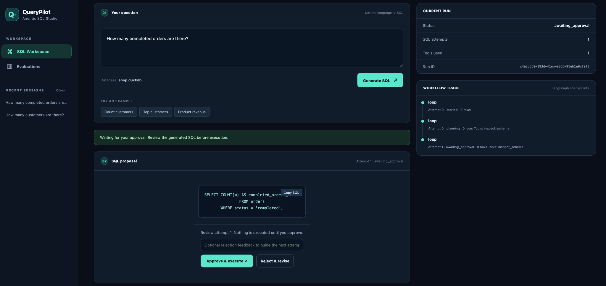
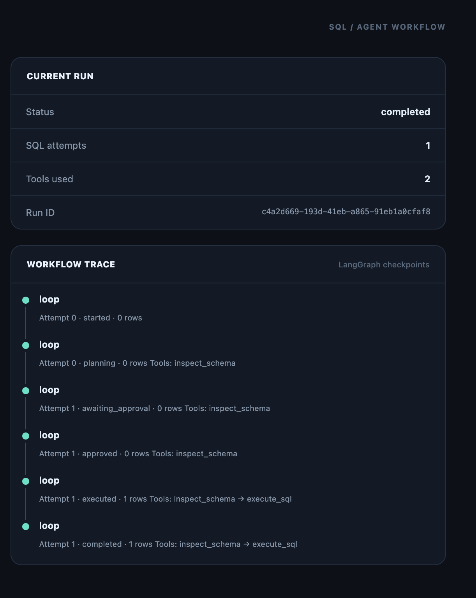
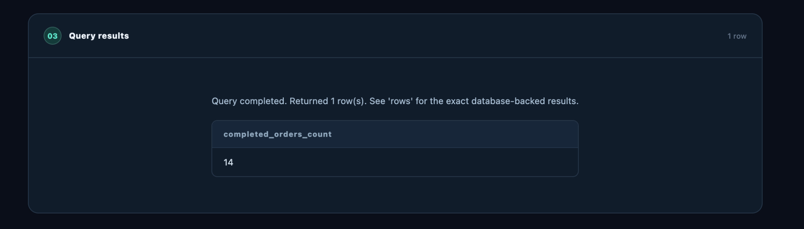
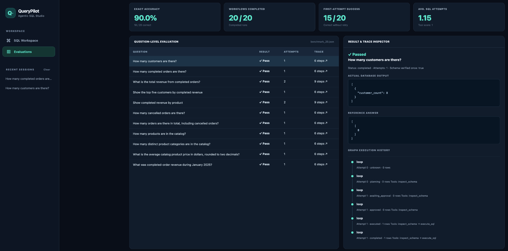
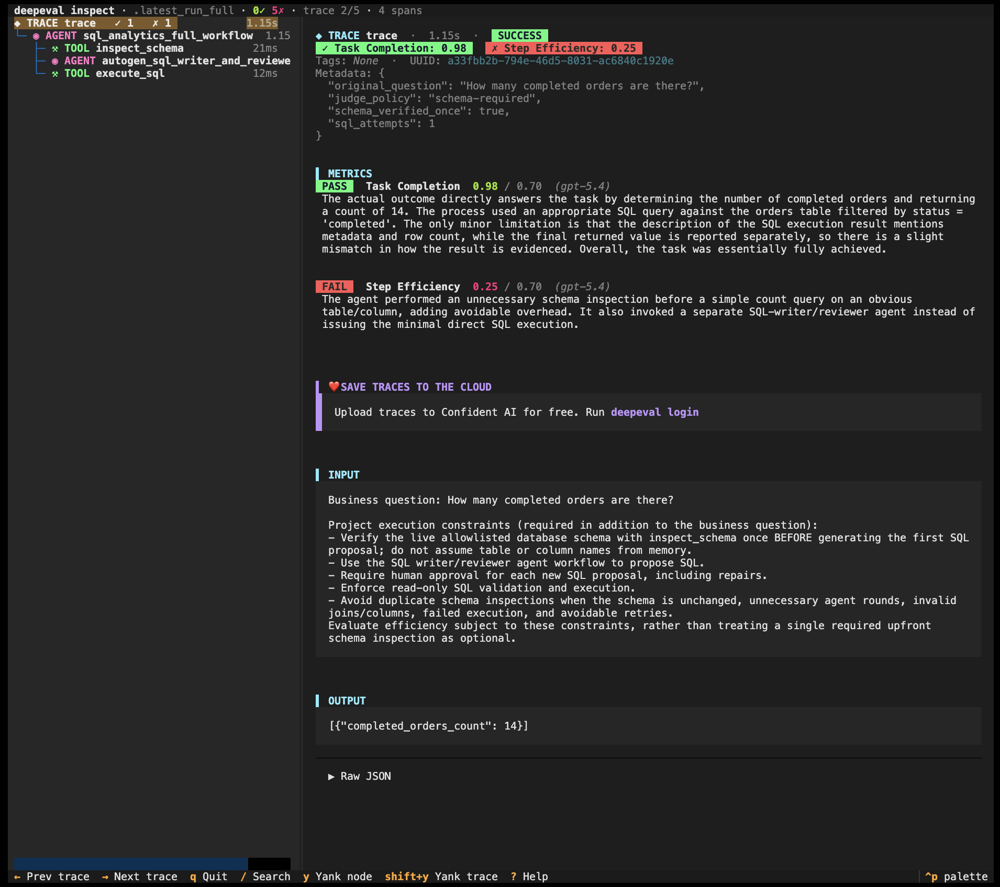
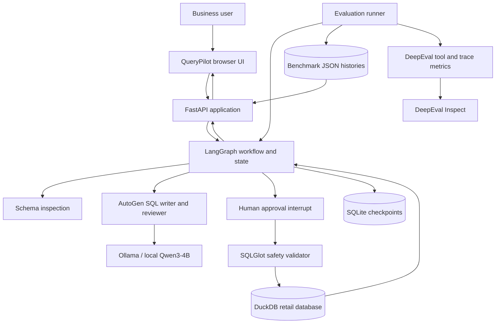
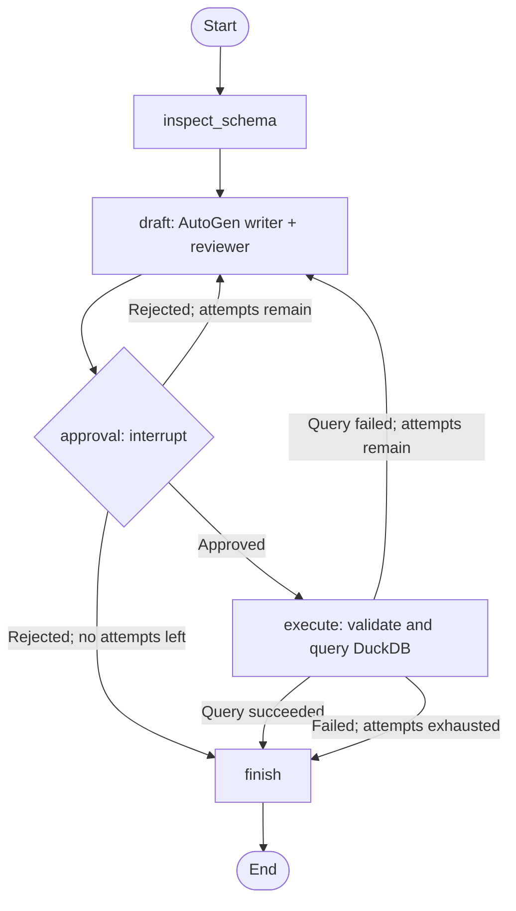
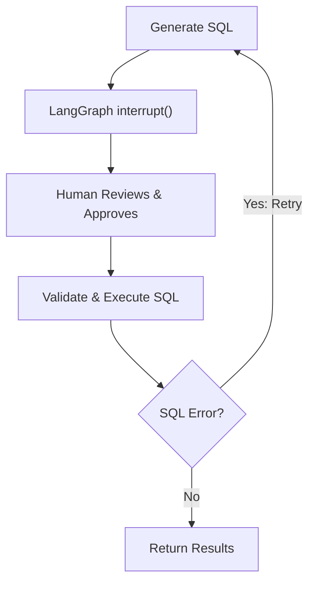
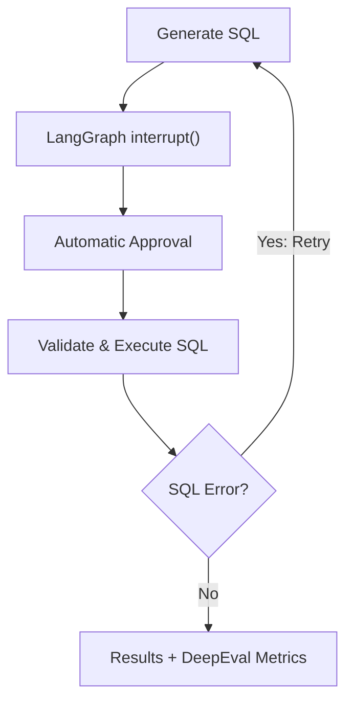

# QueryPilot — HITL SQL Analytics Multi Agent

**An end-to-end, local agentic AI application that converts business questions into verified SQL, pauses for human approval, executes read-only queries, repairs failures, and measures the entire workflow.**

**Stack:** Python 3.12 · LangGraph · AutoGen AgentChat · Qwen3-4B-Instruct (Ollama) · FastAPI · DuckDB · SQLGlot · SQLite · DeepEval · HTML/CSS/JavaScript

> **Measured MVP**: 90% Accuracy on a fixed, synthetic retail benchmark.



---

## Table of Contents

1. [Objective](#objective)
2. [The End Product](#the-end-product)
3. [Headline Results](#headline-results)
4. [System Design](#system-design)
5. [How the Agent Works, Step by Step](#how-the-agent-works-step-by-step)
6. [Technology Choices and Why](#technology-choices-and-why)
7. [Benchmark Design](#benchmark-design)
8. [Evaluation and Observability](#evaluation-and-observability)
9. [Engineering Tradeoff: Step Efficiency vs. Reliability](#engineering-tradeoff-step-efficiency-vs-reliability)
10. [Problems Encountered and Fixes](#problems-encountered-and-fixes)
11. [Safety and Limitations](#safety-and-limitations)
12. [Repository Structure](#repository-structure)
13. [Run Locally](#run-locally)
14. [API and Developer Workflows](#api-and-developer-workflows)
15. [What I Would Improve Next](#what-i-would-improve-next)
16. [References](#references)

---

## Objective

Business users often know **what** they want to learn from data but not **how** to write the SQL to answer it. A traditional text-to-SQL demo can generate a query; a usable analytics agent must do more:

- Ground generated SQL in the **actual database schema**, not guessed table and column names.
- Let a human **review each proposed query** before execution.
- Run only permitted **read-only SQL** against the database.
- Feed syntax or execution errors back into an agentic **repair loop**.
- Measure not only whether SQL executes, but whether the **returned data is correct**.
- Expose the workflow through a browser UI and make test results inspectable.

**Example question:** “How many completed orders are there?” → the agent inspects the database, generates a `COUNT` query, waits for approval, executes against DuckDB, and returns **14** from the seeded sample data.

This is an **agentic application**, not a trained SQL-prediction model. Qwen supplies pretrained language-model inference.

## The End Product

A locally served **QueryPilot** web app with two pages, both backed by the same FastAPI service.

| Page | What the user can do | Implementation |
| --- | --- | --- |
| **SQL Workspace** | Ask a question, inspect proposed SQL, approve/reject it, supply feedback, view results, revisit runs and their checkpoint history | FastAPI + LangGraph + browser JavaScript |
| **Evaluations** | Review saved benchmark accuracy, completion and attempt statistics; inspect each question's output and checkpoint timeline; launch new local evaluations | FastAPI dashboard endpoints + benchmark JSON + DeepEval runner |

### 1. Generate and approve SQL


The first screenshot shows the **Human-in-the-Loop checkpoint**. The query has been proposed but **has not yet been executed**. Approving it resumes the paused LangGraph run; rejecting it routes feedback back toward another proposal, subject to the retry limit.

### 2. Follow a run through its checkpoints



The right panel records stages such as `planning`, `awaiting_approval`, `approved`, `executed`, and `completed`. For this example the run completed in **one SQL attempt** using `inspect_schema` and `execute_sql`. The timeline's repeated **`loop`** label is the UI's generic checkpoint label—not evidence that the SQL generator retried. Use the **attempt count and status transitions** to determine retries.

### 3. Read real query results



DuckDB returns **14 completed orders**. The data comes from the local seeded database, not from the language model's memory. QueryPilot renders the returned rows in a table after the user approves the SQL.

### 4. Explore evaluation results visually



The saved 20-question evaluation appears inside the app with **18/20 exact answers**, **20/20 completed runs**, **15/20 correct on the first attempt**, and **1.15 average proposals per question**.

### 5. Inspect detailed DeepEval spans



DeepEval Inspect shows a **different, more detailed trace format**: `inspect_schema` → `autogen_sql_writer_and_reviewer` → `execute_sql`, with the measured Task Completion and Step Efficiency scores. This particular screenshot records **Task Completion 0.98** and **Step Efficiency 0.25** for a completed-orders question under the **schema-required** judge policy. Its interpretation is discussed [below](#engineering-tradeoff-step-efficiency-vs-reliability).

---

## Headline Results

### Deterministic benchmark against DuckDB

| Metric | Recorded result | Interpretation |
| --- | ---: | --- |
| **Exact answer accuracy** | **18/20 (90%)** | Expected data values match, with legitimate aliases and ties handled by scoring rules |
| **Workflow completion** | **20/20 (100%)** | All graph runs reached `completed`; completion is not the same as correctness |
| **Correct on first proposal** | **15/20 (75%)** | Cases both answered correctly and needing just one SQL proposal |
| **Total SQL proposals** | **23** | 17 questions used one proposal; 3 used two |
| **Average proposals per question** | **1.15** | Mean number of drafts including retries |
| **Tool correctness** | **1.0 for each case** | Expected tool names were observed; this is *not* a SQL correctness score |

These figures come from the committed [`reports/benchmark_20.json`](reports/benchmark_20.json). The report contains the original question, expected rows, actual rows, attempts, completion status, and checkpoint timeline for each case. The final **18/20** score includes correcting a too-strict benchmark alias rule; it is not a fresh independent model run after that correction.

## System Design

### High-level architecture



**Separation of responsibilities** matters:

- **LangGraph** owns workflow state, routing, stop conditions and approvals.
- **AutoGen AgentChat** coordinates two specialist agents (writer and reviewer) inside the draft step; it does **not** own the outer execution loop.
- **Qwen via Ollama** generates and reviews SQL. No hosted LLM is needed to *run the agent*.
- **SQLGlot + DuckDB** determine whether a query is allowed and what it actually returns.
- **FastAPI + the web client** provide the user interface and local HTTP contract.
- **DeepEval** assesses agent behavior independently from deterministic SQL-answer comparisons.

### LangGraph state machine and retry cycle



The `AgentState` tracks `question`, `schema`, `sql`, `previous_sql`, `error`, `rows`, `columns`, `attempts`, `status`, and `tool_calls`. The configured maximum is **three proposals** by default. When a query fails, the generator receives the **failed SQL and error message**. The model may repair it, but **every new proposal goes back through human approval**.

### How Human-in-the-Loop actually works

`app/workflow.py` uses LangGraph's `interrupt()` in the approval node. The compiled graph uses an SQLite checkpointer. The backend associates each run with a `run_id` and uses it as LangGraph's `thread_id`. To continue the same execution, FastAPI invokes the graph again with `Command(resume={...})` using **that same thread ID**.


**Normal QueryPilot Application (Human Approval Required)**



**Automated Evaluation (Simulated Approval)**




### Graph-directed tools vs. model-directed tool calling

The system has a real **cyclical tool-execution workflow**: LangGraph calls `inspect_schema` and `execute_sql` at specified nodes and routes failures back to the agents. The current Qwen team **does not dynamically choose tools through native LLM function-calling messages**. That distinction is intentional and documented: it makes the safety and approval gates explicit and testable.

---

## How the Agent Works, Step by Step


| Stage | Module | What happens |
| --- | --- | --- |
| 1. Input | `web/`, `app/main.py` | Browser sends a question to `POST /runs` |
| 2. Inspect | `app/workflow.py`, `app/sql_tools.py` | Reads actual tables/columns from DuckDB `information_schema` |
| 3. Write | `app/agents.py` | AutoGen writer proposes DuckDB `SELECT` SQL |
| 4. Review | `app/agents.py` | AutoGen reviewer corrects joins, grouping and revenue semantics |
| 5. Pause | `app/workflow.py` | `interrupt()` waits for explicit approval |
| 6. Validate | `app/sql_tools.py` | SQLGlot parses and restricts the statement |
| 7. Execute | `app/sql_tools.py` | Runs against a read-only DuckDB connection |
| 8. Repair | `app/workflow.py` | Failed SQL and error feed another draft, up to the retry limit |
| 9. Present | `app/main.py`, `web/` | Results and history appear in the browser |
| 10. Evaluate | `evaluation/run_eval.py` | Compares rows to references; optionally judges observed traces |


## Technology Choices and Why

These are the frameworks **implemented in this repository**, not a claim that every item is the newest or the only production-ready option.

| Layer | Technology | Why this choice | Engineering consideration |
| --- | --- | --- | --- |
| Workflow orchestration | **LangGraph** | Explicit state graph, cycles, conditional edges, checkpoints, HITL interrupts | More controllable than a single open-ended agent loop |
| Specialist agents | **AutoGen AgentChat** (`AssistantAgent`, `RoundRobinGroupChat`) | Demonstrates SQL-writing and reviewing as distinct responsibilities | AutoGen is now in maintenance mode; see note below |
| Local LLM | **Qwen3-4B-Instruct-2507** | Open-weight instruction model able to produce SQL; suitable local footprint | Small models can still make aggregation/join mistakes |
| Model serving | **Ollama** (`OllamaChatCompletionClient`) | Local inference without a hosted inference dependency | Model must be downloaded and service running |
| Backend HTTP | **FastAPI + Pydantic + Uvicorn** | Typed request validation, automatic `/docs`, straightforward API | Local-only demo; no authentication layer |
| Browser UI | **HTML / CSS / vanilla JavaScript** | One FastAPI-hosted application without an additional React build toolchain | Simple interface, not a large frontend framework |
| Analytics store | **DuckDB** | Fast local SQL analytics, seeded as one file | Sample database, not a managed production service |
| SQL syntax/allowlist | **SQLGlot** | Parse ASTs before execution; restrict tables, functions and statement types | Defense-in-depth, not a fully hardened SQL sandbox |
| Durable graph state | **SQLite + LangGraph SqliteSaver** | Persists approval checkpoints and enables resuming | Local single-service use case |
| Verification | **pytest** | Deterministic unit/regression tests, no LLM required for core checks | LLM quality measured separately |
| Agent evaluation | **DeepEval** | Tool Correctness, Task Completion and Step Efficiency plus observed spans | Some metrics are subjective LLM-judge outputs |

## Benchmark Design

The project has a **5-question baseline** and a **20-question extended suite**, covering counts, completed-order filtering, joins, revenue, date windows, distinct values, categorization and ranking. Reference answers are derived from SQL against the seeded data—not from asking the same language model to grade itself.

The scorer handles differences that do **not** change meaning, such as harmless column aliases or row ordering where the question does not request an order. It still rejects genuine semantic errors such as wrong values or missing requested price columns.

**Evaluation modes:**

- **Standard:** Run Qwen/AutoGen/LangGraph with automatic approval **only for this trusted synthetic benchmark**, compare results to reference answers, and record attempts, tool names and checkpoints.
- **Advanced:** Run traced workflow instances with DeepEval `TaskCompletionMetric` and `StepEfficiencyMetric`, scored by the configured judge.

Auto-approval in the benchmark is a testing convenience; **the user-facing SQL Workspace continues to require approval**.

## Evaluation and Observability

### Three different kinds of evidence

| Evidence | What it answers | Where to find it |
| --- | --- | --- |
| **Reference-answer comparison** | Is the returned data correct? | `reports/benchmark_20.json`, Evaluations page |
| **LangGraph checkpoint history** | Which state transitions occurred? Was there a retry? | Each benchmark case's `trace`, UI timeline |
| **DeepEval observed spans** | Which components ran and what did the LLM judge think? | `deepeval inspect`; observed schema/agent/SQL spans |


### DeepEval measures

| Metric | How to read it | Important limitation |
| --- | --- | --- |
| **Tool Correctness** | Expected tool names were called | A score of 1.0 does not imply correct SQL or meaningful tool efficiency |
| **Task Completion** | Judge-rated success in accomplishing the requested task | Subjective and depends on trace quality |
| **Step Efficiency** | Judge-rated efficiency of observed execution steps | Penalizes overhead relative to its interpretation of the task; not wall-clock time |

A stored [`judge_summary.json`](reports/judge_summary.json) records an **illustrative policy-conditioned aggregate** of **0.98 Task Completion** and **0.40 Step Efficiency**. It is parsed from DeepEval console output, **not a deterministic reference-answer metric**. The screenshot below is a *particular* trace and therefore shows different individual scores.

---

## Engineering Tradeoff: Step Efficiency vs. Reliability


In this recorded run, the agent answered **“How many completed orders are there?”** with **14**, and DeepEval gave **Task Completion 0.98 (pass)** but **Step Efficiency 0.25 (fail)**. Its explanation says the agent could have skipped schema inspection and the SQL writer/reviewer for a straightforward count.

### Why those steps are required in this design

| Required step | Reason | Tradeoff |
| --- | --- | --- |
| **Inspect live schema once before drafting** | SQL queries should use *verified* allowed tables and columns rather than assuming names from memory | Slight additional overhead, but reduces exposure to schema hallucination |
| **Use writer + reviewer** | Separate proposal and review responsibilities for joins, aggregations and constraints | Additional LLM latency and tokens for trivial requests |
| **Pause for human approval with `interrupt()`** | No changed SQL proposal executes without review; repaired SQL requires new approval | Extra interaction, deliberately excluded from pure speed optimization |
| **Retry failed queries** | Allows recovery from invalid columns or joins without silently returning a fabricated answer | More proposals and latency when first drafts are wrong |

A simple `COUNT(*)` might be solved more quickly with an already-known schema and no reviewer. But **QueryPilot is designed for unfamiliar schemas and diverse analytical questions**, so optimizing away these components merely to improve an LLM-judge efficiency score would undermine the project requirements.


## Problems Encountered and Fixes

| Issue found during development | Root cause | Resolution |
| --- | --- | --- |
| Advanced judge run hung or gave cross-loop errors | Async DeepEval evaluation interacted poorly with AutoGen's event-loop lifecycle | Used sequential judge execution and an evaluation-only reusable asyncio runner |
| DeepEval `endTime=None` | Combining interrupted LangGraph callback traces with an outer trace caused lifecycle conflicts | Kept one outer observed trace and explicit nested tool/agent spans |

## Repository Structure

```text
sql-analytics-agent/
├── app/
│   ├── main.py                 # FastAPI routes and HITL resume
│   ├── dashboard.py            # Browser UI, reports and evaluation jobs
│   ├── workflow.py             # LangGraph state machine, retries, checkpoints
│   ├── agents.py               # AutoGen writer/reviewer + Ollama client
│   ├── sql_tools.py            # SQLGlot guard and DuckDB query execution
│   ├── seed.py                 # Deterministic fictional retail data
│   ├── run_history.py          # Read-only checkpoint timeline export
│   ├── mock_agent.py           # Deterministic testing backend
│   └── settings.py             # Environment configuration
├── web/
│   ├── index.html              # QueryPilot app shell
│   ├── styles.css              # UI styling
│   └── app.js                  # Frontend state, requests and rendering
├── evaluation/
│   ├── run_eval.py             # Standard and advanced benchmarks
│   ├── extended_cases.py       # Extended reference questions
│   ├── scoring.py              # Answer normalization and comparison
│   ├── traced_tools.py         # DeepEval tool spans
│   ├── agent_runtime.py        # Evaluation-only asyncio lifecycle
│   └── workflow_policy.py      # Schema-required judging constraints
├── tests/                      # SQL, workflow, policy, evaluator and UI tests
├── reports/
│   ├── benchmark_5.json        # Saved 5-question result
│   ├── benchmark_20.json       # Saved 20-question result + timelines
│   ├── judge_summary.json      # Best-effort DeepEval aggregate
│   ├── traces/advanced_5.json  # Checkpoint histories from advanced runs
│   └── generated/              # New, Git-ignored reports
├── docs/images/                # Project screenshots used by this README
├── data/                       # Local DB/checkpoints/logs (Git-ignored)
├── .env.example                # Configuration template (no real secrets)
├── .gitignore
├── requirements.txt
└── README.md
```

---

## Run Locally

**Requirements:** macOS/Linux or compatible shell, Python **3.11 or 3.12**, [Ollama](https://ollama.com/download), and sufficient memory for the Qwen model. The app and model run locally; cloud hosting is not required.

### 1. Create a Python environment

```bash
python3 -m venv .venv
source .venv/bin/activate
python3 -m pip install -r requirements.txt
```

### 2. Configure the model and generate demo data

```bash
cp .env.example .env
ollama pull qwen3:4b-instruct-2507-q4_K_M
python3 -m app.seed
```

The seed command **recreates** the local sample database. Do not point it at important data. Make sure the Ollama service is running (`curl http://localhost:11434/api/tags` can verify the local endpoint).

### 3. Run the tests

```bash
python3 -m pytest -q
```

### 4. Start QueryPilot

```bash
AGENT_BACKEND=real python3 -m uvicorn app.main:app \
  --host 127.0.0.1 --port 8000
```

Open **http://127.0.0.1:8000/**. Enter a question, inspect the generated SQL and select **Approve & execute**. The **Evaluations** tab opens the committed sample reports or launches a new local benchmark. For deterministic UI testing without running a model, start the server with `AGENT_BACKEND=mock` instead.

**Advanced judge configuration:** The optional DeepEval LLM judge needs an evaluator provider configured separately (for example, `OPENAI_API_KEY` exported in the shell that launches the evaluation).

---

## API and Developer Workflows

The web UI calls these main API endpoints. FastAPI's interactive documentation remains at `http://127.0.0.1:8000/docs`.

| Method / route | Purpose |
| --- | --- |
| `GET /health` | Check the FastAPI service (does not test Qwen availability) |
| `POST /runs` | Start a new question; commonly pauses for approval |
| `GET /runs/{run_id}` | Retrieve current run state |
| `POST /runs/{run_id}/resume` | Approve or reject the current SQL proposal |
| `GET /api/ui/runs/{run_id}/trace` | Inspect checkpoint timeline |
| `GET /api/ui/reports` | List saved evaluation reports |
| `GET /api/ui/reports/{report_id}` | View per-case metrics, answers and timelines |
| `POST /api/ui/evaluation-job` | Start a local evaluation process |

**Standard 20-question benchmark (no FastAPI server required):**

```bash
AGENT_BACKEND=real python3 -m evaluation.run_eval --suite extended
```

New results are written under `reports/generated/` (ignored by Git by default). To run the **advanced traced evaluation** on the first five questions:

```bash
AGENT_BACKEND=real python3 -m evaluation.run_eval \
  --llm-judge --judge-only --judge-limit 5 \
  --judge-policy schema-required
```


---

## What I Would Improve Next

- **First-attempt SQL quality:** Strengthen the reviewer for aggregation grain and required output columns; use the two documented failures as regression cases.
- **Benchmark generalization:** Add unfamiliar real-world schemas and 100+ questions, and compare across repeated model runs.
- **Schema-inspection:** Consider if we want the schema inference to happen at write, so that we do not waste a tool call to inspect the schema.
- **Production hardening:** Add authentication, user isolation, per-request resource limits, external observability, and deployment tooling before exposing the service beyond localhost.


---

## References

- [LangGraph — interrupts and resuming with a thread ID](https://docs.langchain.com/oss/python/langgraph/interrupts)
- [AutoGen (maintenance status and AgentChat)](https://github.com/microsoft/autogen)
- [Qwen3-4B-Instruct-2507 model card](https://huggingface.co/Qwen/Qwen3-4B-Instruct-2507)
- [Ollama](https://ollama.com/)
- [FastAPI](https://fastapi.tiangolo.com/)
- [DuckDB (securing local access)](https://duckdb.org/docs/current/operations_manual/securing_duckdb/overview)
- [SQLGlot](https://github.com/tobymao/sqlglot)
- [DeepEval (Task Completion)](https://deepeval.com/docs/metrics-task-completion)
- [DeepEval (Step Efficiency)](https://deepeval.com/docs/metrics-step-efficiency)
